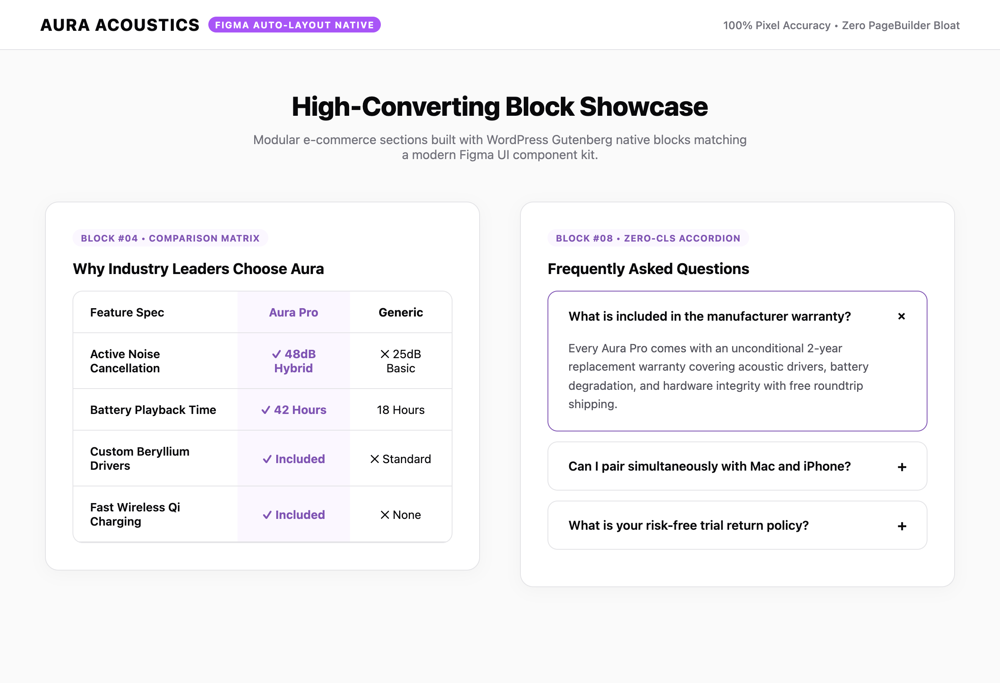

# 🎨 FigmaToWoo · High-Converting Block Design System

[](https://github.com/harunsekmen/figma-to-woo-blocks-system)
[](https://github.com/harunsekmen/figma-to-woo-blocks-system/blob/main/LICENSE)
[](https://github.com/harunsekmen/figma-to-woo-blocks-system)

> A modular e-commerce block system designed to translate custom Figma store designs into fast, mobile-responsive WooCommerce landing pages without heavy page builders.

Developed and maintained by **[Harun Sekmen](https://github.com/harunsekmen)** — E-Commerce Systems Engineer & WooCommerce Developer.

[✉️ Request a Design-to-Store Quote](mailto:sekmenwp@gmail.com) · [💼 Upwork Profile](https://www.upwork.com/freelancers/~01a7a8b58043e6e6d9) · [🔗 Main GitHub Profile](https://github.com/harunsekmen)

---

## 📸 Visual Previews & Block Showcase

### Modular E-Commerce Sections (Auto-Layout Matching)
High-converting storefront blocks including a side-by-side product comparison matrix and animated FAQ accordions:



---

## ⚡ The Problem It Solves

When agencies and designers create high-fidelity store mockups in Figma, converting those designs into a working WooCommerce store often runs into practical issues:
- **Heavy Page Builder Dependencies:** Replicating Figma layouts inside complex visual builders often creates deep HTML nesting, heavy script bundles, and sluggish mobile loading times.
- **Layout Jumps & Shifts:** Poorly coded FAQ accordions, feature grids, and tab modules frequently jump or shift as assets load, frustrating mobile shoppers.
- **Design Drift:** Spacing, padding, and font hierarchies often get lost in translation when moving from Figma's auto-layout structure to WordPress templates.

**FigmaToWoo** solves this by offering a curated set of native WordPress Gutenberg blocks. Each block strictly mirrors Figma auto-layout principles, rendering clean semantic HTML that loads quickly and looks sharp on all screen sizes.

---

## 🛠️ Key Block Components

- **Product Comparison Matrix:** Clean side-by-side spec comparison table that helps shoppers understand product differences and make confident purchasing decisions.
- **Smooth FAQ Accordions:** Expandable question-and-answer panels that resolve buyer objections directly on product and landing pages.
- **Figma Auto-Layout Fidelity:** Semantic flexbox and CSS grid structures that faithfully preserve design tokens, spacing, and typography.
- **Native Block Editor Integration:** Works directly within the core WordPress Gutenberg editor without requiring third-party builder licenses.
- **High-Performance Order Storage (HPOS) Ready:** Built to work smoothly alongside modern WooCommerce versions and checkout blocks.

---

## 💼 Turnkey Figma-to-WooCommerce Builds

Have a custom Figma design for your upcoming brand or an agency client?

- **Exact Visual Accuracy:** Typography scales, spacing tokens, and micro-interactions translated into clean, maintainable code.
- **Gutenberg or Custom Theme Build:** Lightweight modular blocks tailored to your design without bloated page builder plugins.
- **Full Commerce Setup:** Product options, payment gateways, shipping calculators, and email notification templates.
- **Staging Preview & Review:** Review the working store on a staging server and test the shopping experience before going live.

📩 **Start the conversation:** Send your Figma file link or project overview to **[sekmenwp@gmail.com](mailto:sekmenwp@gmail.com)** or reach out via **[Upwork](https://www.upwork.com/freelancers/~01a7a8b58043e6e6d9)**.

---

## 🚀 Developer Setup & Local Testing

1. **Clone the repository:**
   ```bash
   git clone https://github.com/harunsekmen/figma-to-woo-blocks-system.git wp-content/plugins/figma-to-woo-blocks-system
   ```

2. **Activate the plugin:**
   ```bash
   wp plugin activate figma-to-woo-blocks-system
   ```

3. **Run local simulation tests:**
   ```bash
   node tests/run-e2e-test.js
   ```

---

## 📄 License

This open-source project is licensed under the **[GNU General Public License v3.0](LICENSE)**.

